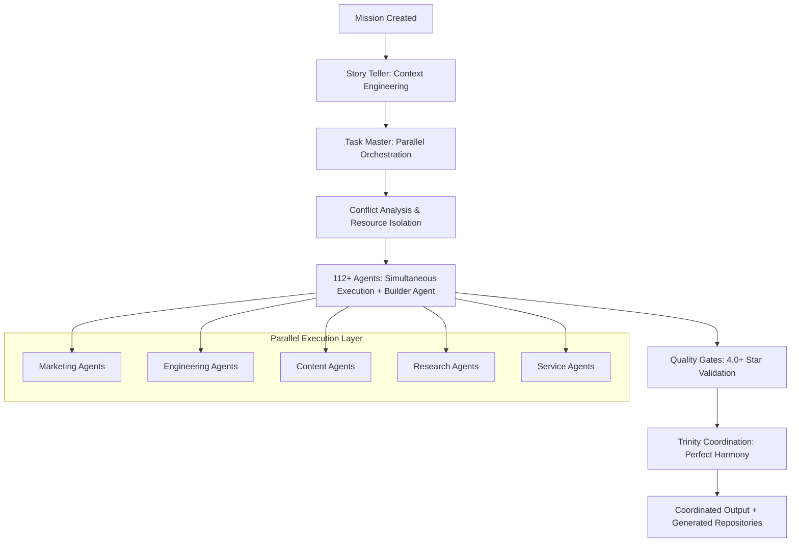

# ONE Ontology 
## Overview

**ONE** is activated by a single command (`npx oneie`), configured by a single file (`/me/me.md`),

The Builder Agent now enables universal repository generation, transforming any strategic mission into production-ready applications with Trinity architecture integration in under 60 seconds. Complete Turbo monorepos with Next.js 15, React 19, Convex, and 112+ AI agents are instantly available through `npx oneie`.

## Mission-1: The Beautiful Simplicity Implementation

### The Three Ones That Change Everything
```
1. ONE Command:  npx oneie       # Installs your AI universe + generates production repository
2. ONE Source:   /one/me/me.md     # Your digital DNA file  
3. ONE Generate: /one:generate   # Builds everything with turbo (now enhanced with Builder Agent)
```

### Mission-2 Enhancement: Universal Repository Generation
```
4. Builder Agent: Transforms missions into production-ready applications
5. Repository Generation: Complete Turbo monorepos in <60 seconds  
6. Trinity Integration: .claude/.one/one architecture in every generated repository
7. Universal Access: 112+ AI agents immediately available in generated environments
```

### Brand ONE as your own. It's "MySpace for humans and AI agents"

**This isn't just positioning. This is the story that spreads to 100 million people:**

- **Nostalgia Trigger**: "Remember spending hours customizing your MySpace?"
- **AI Evolution**: "Now imagine that, but with AI agents trained on your personality, business or government"
- **Instant Recognition**: "Top 8 Friends → Top 8 AI Agents"
- **Viral Moment**: "How many agents and people is your ONE space?" becomes the new social flex

## 🌀 Spiral Architecture: Input → Intelligence → Transformation

ONE operates as a **3-level spiral system** that transforms any input into complete business transformation:

### Level 1: ONE Framework (Universal Business DNA)
The foundational layer providing universal methodology templates that work for any business, any industry, any scale.

### Level 2: Industry Templates (Sector Specialization)
Industry-specific customizations that inherit from ONE framework - crypto, SaaS, ecommerce, and more.

### Level 3: Client Implementations (Hyper-Personalization)  
Your unique implementation with complete automation, personalization, and continuous optimization.

**The Magic:** Input any URL, idea, or competitor → 30 seconds of AI research → Complete business transformation system with game-like progression → Builder Agent generates production-ready repository in 60 seconds!

## What Gets Created On Install

```
your-project/
├── .one/                       # 🔒 Hidden Orchestration Engine & Parallel Coordination Platform
│   ├── agents/                # Platform resources (moved to .claude/agents/ for execution)
│   ├── teams/                 # Agent collaboration groups with conflict-free coordination
│   ├── missions/              # Your goals (auto-generated from me.md)
│   ├── stories/               # Your narratives (spawned from missions with parallel execution context)
│   ├── workflows/             # Your success systems (cascade orchestration & conflict prevention)
│   ├── templates/             # Document frameworks (parallel-execution-optimized)
│   ├── tasks/                 # Actionable work units (designed for conflict-free parallel execution)
│   ├── checklists/            # Quality validation (R.O.C.K.E.T.) with parallel quality gates
│   ├── data/                  # Your knowledge base (resource isolation patterns)
│   ├── playbooks/             # Industry expertise (parallel execution methodologies)
│   ├── tools/                 # Automation utilities (conflict detection & prevention)
│   ├── hooks/                 # 🎯 Automated magic with parallel coordination
│   │   ├── file-organization-monitor.js    # Keeps everything perfect during parallel execution
│   │   ├── naming-convention-enforcer.js   # Beautiful naming across simultaneous agent outputs
│   │   ├── content-validator.js            # R.O.C.K.E.T. quality across 79+ parallel streams
│   │   ├── ontology-compliance.js          # Structure perfection during parallel coordination
│   │   ├── viral-optimization.js           # Makes content shareable without conflicts
│   │   ├── auto-organizer.js               # Maintains order during parallel execution
│   │   ├── conflict-detector.js            # Real-time conflict detection across parallel agents
│   │   └── resource-coordinator.js         # Intelligent resource isolation and access control
│   ├── apps/                  # Multi-platform universe
│   │   ├── web/              # Your MySpace-style website
│   │   ├── mobile/           # Your AI space in your pocket
│   │   ├── desktop/          # Your AI command center
│   │   └── cli/              # Your power user tools
│   └── packages/              # Shared magic
│       ├── one/              # Core personality engine
│       ├── ui/               # Beautiful MySpace-inspired components
│       ├── library/           # AI orchestration system
│       ├── agents/            # Content multiplication engine
├── /me/                        # 🎨 Your Digital Identity (Like MySpace Profile)
│   ├── me.md                  # YOUR EVERYTHING (edit this!)
│   ├── assets/               # Your logos, avatars, GIFs
│   │   ├── avatar.png        # Your profile pic
│   │   ├── background.gif    # Your space background
│   │   ├── theme-song.mp3    # Your profile music (yes!)
│   │   └── logo.svg          # Your brand
│   ├── themes/               # Your custom MySpace-style themes
│   │   ├── cyberpunk.css     # Matrix vibes
│   │   ├── classic-myspace.css # 2005 nostalgia
│   │   ├── professional.css  # Business mode
│   │   └── chaos.css         # Maximum personality
│   └── templates/            # Your sellable configurations
└── package.json               # With ONE integration magic
```

## 🔄 The Spiral Flow Process

### Input Processing → Research Intelligence → Game-Like Journey

```yaml
spiral_flow:
  # INSTANT INPUT PROCESSING
  input_types:
    - website_url: "Analyze any website instantly"
    - business_idea: "Transform ideas into systems"
    - competitor_name: "Decode competitive strategies"
    - industry_term: "Generate industry frameworks"
    - problem_statement: "Build complete solutions"
  
  # 30-SECOND RESEARCH INTELLIGENCE
  research_swarm:
    web_scraper_agent: "Extract company data & user journeys"
    market_researcher: "Industry analysis & market sizing"
    competitor_analyzer: "Competitive landscape mapping"
    customer_intelligence: "Social sentiment & behavior patterns"
    foundation_synthesizer: "Merge research into strategic insights"
  
  # 60-SECOND FOUNDATION GENERATION
  foundation_components:
    company_dna: "AI-generated mission & unique value"
    market_intelligence: "Data-driven market opportunities"
    customer_avatars: "Research-based buyer personas"
    strategic_roadmap: "AI-ranked prioritized actions"
  
  # GAME-LIKE JOURNEY CREATION
  level_progression:
    foundation_world: "4 levels + boss (Strategic Clarity)"
    attract_world: "6 levels + boss (Viral Growth)"
    convert_world: "8 levels + boss (Sales Mastery)"
    grow_world: "10 levels + boss (Market Domination)"
    
  gamification_elements:
    - progress_bars: "Visual completion tracking"
    - achievement_badges: "Milestone celebrations"
    - score_systems: "Performance-based points"
    - leaderboards: "Competitive elements"
    - power_ups: "Performance boosters"
```

## The Cascade Parallel Execution System

### Mission → Story → Task → Agent: Conflict-Free Parallel Orchestration

The ONE framework's revolutionary cascade system enables **112+ agents to execute simultaneously** without conflicts through intelligent resource isolation and trinity architecture coordination, now enhanced with the Builder Agent for universal repository generation.

#### Parallel Execution Architecture

```yaml
cascade_parallel_system:
  # TRINITY LAYERS enable conflict-free coordination
  execution_layer: ".claude/"     # 112+ agents with parallel execution capabilities + Builder Agent
  platform_layer: ".one/"        # Immutable resources with conflict prevention + repository templates
  workspace_layer: "one/"        # Coordinated outputs from parallel execution + generated repositories
  
  # RESOURCE ISOLATION prevents agent conflicts
  resource_boundaries:
    file_access: "Agents work on different file sets or file sections"
    directory_isolation: "Clear directory boundaries for parallel operations"
    template_versioning: "Multiple template versions for simultaneous use"
    workflow_partitioning: "Parallel workflow streams with merge points"
    
  # QUALITY GATES maintain 4.0+ stars across parallel streams
  parallel_quality_system:
    real_time_monitoring: "Hooks monitor all 79+ agents simultaneously"
    conflict_detection: "Automatic detection and resolution of resource conflicts"
    quality_synchronization: "4.0+ star standards across all parallel activities"
    cascade_coordination: "Perfect Mission → Story → Task → Agent flow harmony"
```

#### Conflict Prevention Strategies

```yaml
conflict_prevention_matrix:
  # TEMPORAL ISOLATION: Time-based coordination
  execution_timing:
    sequential_phases: "Critical operations execute in coordinated sequence"
    parallel_phases: "Independent operations execute simultaneously"
    merge_points: "Coordinated integration of parallel outputs"
    
  # SPATIAL ISOLATION: Resource-based separation
  resource_separation:
    file_boundaries: "Each agent works on designated files or sections"
    directory_ownership: "Clear directory access patterns for each agent"
    template_isolation: "Multiple template instances for parallel use"
    
  # FUNCTIONAL ISOLATION: Role-based coordination
  agent_specialization:
    domain_expertise: "Agents work within their specialized domains"
    cross_functional_protocols: "Clear handoff procedures between domains"
    quality_gates: "Validation checkpoints prevent conflicts"
    
  # COORDINATION MECHANISMS: Trinity-powered harmony
  trinity_coordination:
    hook_automation: "Real-time coordination through automated systems"
    workflow_orchestration: "Cascade workflows prevent resource contention"
    quality_enforcement: "4.0+ star standards maintained across all parallel activities"
```

#### Parallel Agent Spawning Process



#### Trinity Architecture for Parallel Coordination

The trinity structure (.claude/.one/one) enables perfect parallel execution through:

- **.claude/**: Execution layer with 112+ agents including Builder Agent for universal repository generation
- **.one/**: Platform foundation with immutable resources, conflict prevention, and repository templates
- **one/**: User workspace receiving coordinated outputs and generated production-ready repositories

**Result**: Mission → Story → Task → Agent cascade spawns multiple agents working simultaneously while maintaining perfect quality and coordination through the trinity architecture. The Builder Agent enables universal `npx oneie` access, creating production-ready repositories with Trinity integration in under 60 seconds.

## 🧠 Research Intelligence Architecture

### Automated Research Swarm System

```yaml
research_intelligence:
  # RESEARCH AGENTS SWARM
  web_scraper_agent:
    capabilities:
      - extract_company_data: "Pull mission, values, team info"
      - analyze_website_structure: "Map user journey & conversion paths"
      - identify_key_pages: "Find critical business information"
      - content_extraction: "Harvest marketing messages & positioning"
    
  market_researcher:
    capabilities:
      - industry_analysis: "Market size, growth trends, dynamics"
      - competitive_landscape: "Key players, market share, positioning"
      - regulatory_environment: "Compliance requirements & opportunities"
      - technology_trends: "Emerging tech & disruption patterns"
    
  competitor_analyzer:
    capabilities:
      - feature_comparison: "Product/service feature matrices"
      - pricing_analysis: "Pricing models & strategies"
      - marketing_tactics: "Campaign analysis & channel strategy"
      - weakness_identification: "Gaps & competitive opportunities"
    
  customer_intelligence:
    capabilities:
      - social_sentiment: "Twitter, Reddit, Discord analysis"
      - review_mining: "Customer feedback & pain points"
      - demographic_analysis: "Target audience profiling"
      - behavioral_patterns: "Buying journey & decision factors"
    
  foundation_synthesizer:
    capabilities:
      - merge_all_research: "Consolidate multi-source intelligence"
      - generate_insights: "AI-powered strategic recommendations"
      - create_foundation: "Build complete business foundation"
      - identify_opportunities: "Rank growth opportunities by impact"

  # INTEGRATION WITH CASCADE
  cascade_integration:
    mission_commander: "Uses research to define strategic objectives"
    story_teller: "Transforms insights into engineering narratives"
    task_master: "Breaks research findings into actionable tasks"
    specialized_agents: "Execute based on research intelligence"
```

## 🎮 Game Experience Layer

### Level Progression System with Achievement Mechanics

```yaml
game_architecture:
  # WORLD STRUCTURE
  foundation_world:
    levels:
      - company_clarity: "Review & approve AI-generated profile"
      - market_mastery: "Understand competitive dynamics"
      - customer_connection: "Validate target avatars"
      - strategic_alignment: "Finalize complete foundation"
    boss_battle: "Foundation Certification Challenge"
    rewards: "Unlock Attract World + Foundation Badge"
    
  attract_world:
    levels:
      - hook_laboratory: "Create attention-capturing content"
      - gift_workshop: "Design valuable lead magnets"
      - identity_optimizer: "Perfect lead capture systems"
      - viral_mechanics: "Build sharing mechanisms"
      - community_builder: "Grow engaged audience"
      - traffic_accelerator: "Scale visitor acquisition"
    boss_battle: "Launch Viral Campaign Challenge"
    rewards: "Unlock Convert World + Growth Hacker Badge"
    
  convert_world:
    levels:
      - engagement_sequences: "Build relationship funnels"
      - sales_psychology: "Master persuasion principles"
      - offer_architect: "Design irresistible offers"
      - objection_handler: "Overcome purchase barriers"
      - checkout_optimizer: "Maximize conversion rates"
      - payment_processor: "Setup transaction systems"
      - nurture_automator: "Post-purchase sequences"
      - retention_systems: "Build loyalty programs"
    boss_battle: "Sales System Mastery Challenge"
    rewards: "Unlock Grow World + Revenue Master Badge"
    
  grow_world:
    levels:
      - upsell_strategist: "Expand customer value"
      - cross_sell_designer: "Create product ecosystems"
      - referral_engineer: "Build viral loops"
      - education_hub: "Establish thought leadership"
      - community_catalyst: "Foster user-generated growth"
      - partnership_broker: "Strategic collaborations"
      - automation_wizard: "Scale without hiring"
      - data_scientist: "Predictive analytics"
      - market_expander: "New segment penetration"
      - category_creator: "Define new markets"
    boss_battle: "Market Domination Challenge"
    rewards: "Unicorn Status + Industry Leader Badge"

  # GAMIFICATION MECHANICS
  achievement_system:
    speed_achievements:
      - lightning_founder: "Complete foundation in <5 minutes"
      - rapid_launcher: "First campaign live in <1 hour"
      - velocity_victor: "10x growth in 30 days"
    
    quality_achievements:
      - perfectionist: "100% quality scores across all levels"
      - data_driven: "All decisions backed by research"
      - customer_champion: "95%+ customer satisfaction"
    
    impact_achievements:
      - viral_sensation: "Content reaches 1M+ people"
      - revenue_rocket: "First $10K month achieved"
      - market_mover: "Become top 3 in category"
    
  scoring_system:
    level_points: "100-1000 per level based on performance"
    time_bonus: "Extra points for speed completion"
    quality_multiplier: "2x-5x based on execution quality"
    social_bonus: "Points for sharing & collaboration"
```

## 🔄 Template Inheritance Chain

### 3-Level Content Generation System

```yaml
template_cascade:
  # LEVEL 1: UNIVERSAL TEMPLATES (ONE Framework)
  universal_layer:
    location: "one/framework/"
    templates:
      - company_dna_tmpl: "Universal business identity"
      - market_intel_tmpl: "Universal market analysis"
      - customer_avatar_tmpl: "Universal buyer personas"
      - hook_tmpl: "Universal attention capture"
      - gift_tmpl: "Universal value delivery"
      - engage_tmpl: "Universal relationship building"
    variables:
      - "{{company_mission}}"
      - "{{target_customer}}"
      - "{{unique_value}}"
      - "{{market_opportunity}}"
    
  # LEVEL 2: INDUSTRY TEMPLATES (Sector Specific)
  industry_layer:
    location: "industries/{industry}/"
    inheritance: "extends universal_layer"
    crypto_example:
      additional_templates:
        - token_character_tmpl: "AI character development"
        - tokenomics_tmpl: "Token economics design"
        - airdrop_campaign_tmpl: "Distribution strategies"
      additional_variables:
        - "{{token_symbol}}"
        - "{{character_name}}"
        - "{{community_platform}}"
    
  # LEVEL 3: CLIENT IMPLEMENTATION (Personalized)
  client_layer:
    location: "clients/{client-id}/"
    inheritance: "extends industry_layer"
    personalization:
      - brand_assets: "Logos, colors, fonts, voice"
      - custom_content: "AI-generated unique content"
      - performance_data: "Analytics-driven optimization"
      - competitive_intel: "Real-time market positioning"
    
  # DYNAMIC GENERATION
  content_engine:
    process:
      1_template_selection: "Choose appropriate template level"
      2_variable_injection: "Apply cascading variables"
      3_ai_enhancement: "Generate unique variations"
      4_quality_validation: "Ensure 4.0+ star quality"
      5_performance_tracking: "Monitor & optimize results"
```

## 🚀 Success Metrics & KPIs

### Spiral System Performance Indicators

```yaml
success_framework:
  # INPUT PROCESSING METRICS
  speed_metrics:
    input_analysis: "<30 seconds for any input type"
    research_completion: "<60 seconds full intelligence"
    foundation_generation: "<2 minutes complete profile"
    game_setup: "Instant level progression creation"
  
  # USER ENGAGEMENT METRICS
  experience_metrics:
    onboarding_completion: ">90% finish foundation"
    level_progression: ">60% reach convert world"
    achievement_unlock: "15+ badges average per user"
    daily_active_usage: ">40% return daily"
  
  # BUSINESS IMPACT METRICS
  transformation_metrics:
    implementation_rate: ">80% apply recommendations"
    performance_improvement: ">70% see results in 30 days"
    roi_achievement: "5x average ROI improvement"
    market_position: ">70% improve competitive standing"
  
  # VIRAL GROWTH METRICS
  expansion_metrics:
    user_referrals: "3.5 average referrals per user"
    template_marketplace: ">10K templates created monthly"
    community_growth: "100% month-over-month growth"
    network_effects: "Value increases exponentially with users"
```

## 🌟 The ONE Advantage: Spiral + Cascade + Game

**What makes ONE revolutionary:**

1. **Instant Intelligence**: Any input → Complete business system in 90 seconds
2. **Parallel Execution**: 79+ agents working simultaneously without conflicts
3. **Game-Like Addiction**: Business development becomes as engaging as Candy Crush
4. **Template Inheritance**: Universal → Industry → Personal content cascade
5. **Continuous Optimization**: AI-driven improvements based on real performance
6. **Viral Mechanics**: Built-in growth loops and network effects
7. **Quality Gates**: 4.0+ star standards at every level
8. **MySpace Freedom**: Complete customization with AI intelligence

**The Result**: Transform any idea, URL, or competitor into a complete, game-ified business transformation system that users actually want to use every day, with 79+ AI agents executing in perfect parallel harmony to achieve 100x faster results than traditional approaches.

---

*ONE: Where MySpace nostalgia meets AI intelligence meets game addiction meets viral growth - creating the perfect storm for 100 million user adoption.*
