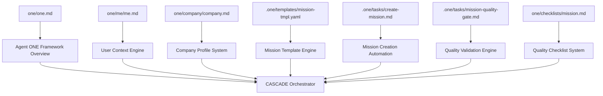

# Story 1.1: Agent ONE & Mission System

**Mission:** Mission-1 CASCADE Workflow Implementation  
**Story:** Agent ONE Initialization & Mission Creation Infrastructure  
**Priority:** P0 - Foundation Critical  
**Teams:** engineering-team, mission-command  
**Status:** Implementation Ready  

## 📖 The Engineering Narrative

Agent ONE serves as the foundational orchestrator of the CASCADE workflow system, providing users with seamless initialization of their production-ready Mission → Story → Task → Agent environment. This story establishes the technical infrastructure for mission creation, user configuration, and company profiling that enables the 4-level quality gate validation system.

The narrative centers on creating a bulletproof foundation where every user gets consistent, high-quality initialization regardless of their domain expertise. Agent ONE guides users through the essential setup phases while automatically establishing the quality gates that prevent cascade failures downstream.

## 🏗️ Architecture Design

### CASCADE Integration Architecture

```yaml
agent_one_system:
  initialization_layer:
    - user_profile: "one/me/me.md" 
    - company_context: "one/company/company.md"
    - framework_overview: "one/one.md"
    
  mission_creation_engine:
    - template_processor: ".one/templates/mission-tmpl.yaml"
    - quality_validation: ".one/tasks/mission-quality-gate.md" 
    - automated_checklist: "one/checklists/mission.md"
    
  orchestration_layer:
    - workflow_automation: ".one/tasks/create-mission.md"
    - cascade_validation: "Mission → Story → Task → Agent"
    - quality_enforcement: "4.0+ stars at every level"
```

### File Architecture Flow



## 📋 Implementation Plan

### Phase 1: Foundation Files (Priority: P0)

#### File 1: `/one/one.md` - Framework Overview Enhancement
**Purpose:** Central CASCADE workflow documentation and Agent ONE integration  
**Technical Requirements:**
- Complete 3 Levels architecture documentation
- Agent ONE initialization workflow
- CASCADE quality gate system explanation
- 112+ agent ecosystem integration points
- Universal accessibility patterns (12-year-old to enterprise)

**Implementation Specifications:**
- Enhance existing content with Agent ONE integration points
- Add initialization workflow section
- Document quality gate enforcement patterns
- Include agent coordination workflows
- Maintain professional engineering voice

#### File 2: `/one/me/me.md` - User Configuration Template Enhancement
**Purpose:** Intelligent user profiling for personalized CASCADE experience  
**Technical Requirements:**
- Professional context capture (role, industry, goals)
- CASCADE workflow preferences
- Agent team personalization
- Quality standard preferences
- Communication style adaptation

**Implementation Specifications:**
- Expand existing template with CASCADE-specific fields
- Add agent preference configuration
- Include quality standard selection
- Implement workflow customization options
- Maintain privacy and security standards

#### File 3: `/one/company/company.md` - Company Profile Structure
**Purpose:** Company context for mission alignment and agent specialization  
**Technical Requirements:**
- Company identity and mission alignment
- Market positioning context
- Technical infrastructure profile
- Team structure and roles
- Business objectives and KPIs

**Implementation Specifications:**
- Create comprehensive company profiling template
- Include market context fields
- Add technical capability assessment
- Implement team structure mapping
- Establish KPI tracking framework

### Phase 2: Mission Creation Automation (Priority: P0)

#### File 4: `.one/tasks/create-mission.md` - Mission Creation Automation
**Purpose:** Automated mission creation workflow with quality enforcement  
**Technical Requirements:**
- Step-by-step mission creation process
- Template selection and customization
- Quality gate integration
- Agent assignment automation
- Progress tracking and validation

**Implementation Specifications:**
- Document mission creation workflow steps
- Define template processing automation
- Implement quality gate checkpoints
- Create agent assignment logic
- Establish progress tracking mechanisms

#### File 5: `.one/templates/mission-tmpl.yaml` - Enhanced Mission Template
**Purpose:** Production-ready mission template with quality gates  
**Technical Requirements:**
- Interactive elicitation system
- Quality validation integration
- Agent assignment automation
- CASCADE workflow hooks
- 4.0+ star validation requirements

**Implementation Specifications:**
- Enhance existing template with quality gates
- Add CASCADE workflow integration points
- Implement automated agent assignment
- Create validation checkpoints
- Establish quality score tracking

#### File 6: `.one/tasks/mission-quality-gate.md` - Automated Validation
**Purpose:** Automated mission quality validation with 4.0+ star requirement  
**Technical Requirements:**
- Comprehensive validation criteria
- Automated quality scoring
- Pass/fail determination logic
- Feedback generation system
- Integration with CASCADE workflow

**Implementation Specifications:**
- Define validation criteria and scoring
- Implement automated quality assessment
- Create pass/fail decision logic
- Generate improvement feedback
- Integrate with mission creation workflow

#### File 7: `/one/checklists/mission.md` - Quality Checklist
**Purpose:** Comprehensive mission quality checklist with 20+ validation criteria  
**Technical Requirements:**
- Strategic clarity assessment
- Resource allocation validation
- Success criteria verification
- Timeline feasibility check
- Agent assignment optimization

**Implementation Specifications:**
- Create comprehensive quality checklist
- Define 20+ validation criteria
- Implement scoring methodology
- Add quality improvement guidance
- Establish threshold requirements

## 🔧 Quality Standards

### Engineering Excellence Criteria

#### Code Quality Standards
- **No JavaScript**: Pure Markdown (.md) and YAML (.yaml) implementation
- **Template Processing**: YAML-based interactive document generation
- **Quality Gates**: 4.0+ star validation at every cascade level
- **Documentation**: Comprehensive technical specifications
- **Integration**: Seamless CASCADE workflow compatibility

#### CASCADE Integration Requirements
- **Mission → Story Flow**: Automatic story spawning from missions
- **Quality Enforcement**: Automated validation prevents progression failures
- **Agent Coordination**: Intelligent routing to 112+ specialized agents
- **Progress Tracking**: Real-time dashboard integration
- **Performance Monitoring**: Quality score tracking and analytics

#### User Experience Standards
- **Universal Accessibility**: 12-year-old to Fortune 500 usability
- **Professional Voice**: Efficient, results-driven communication
- **Interactive Guidance**: Step-by-step workflow assistance
- **Error Prevention**: Quality gates prevent cascade failures
- **Performance**: Sub-30 second initialization times

### Validation Criteria

#### Technical Validation
- [ ] All files validate against CASCADE architecture requirements
- [ ] YAML templates process correctly through elicitation system
- [ ] Quality gates integrate seamlessly with workflow automation
- [ ] Agent assignment logic functions correctly
- [ ] Progress tracking operates in real-time

#### Quality Validation
- [ ] Mission creation achieves 4.0+ star quality consistently
- [ ] User profiling captures sufficient context for personalization
- [ ] Company profiling enables effective agent specialization
- [ ] Quality checklists provide comprehensive validation coverage
- [ ] Documentation maintains engineering excellence standards

#### Integration Validation
- [ ] CASCADE workflow progression functions smoothly
- [ ] Agent coordination routing operates correctly
- [ ] Quality score propagation works across cascade levels
- [ ] Real-time monitoring provides accurate feedback
- [ ] System performance meets sub-30 second requirements

## 🔗 Integration Points

### Story 1.1 CASCADE Integration

#### Upstream Dependencies
- **Mission-1 Foundation**: 3 Levels architecture implementation complete
- **CASCADE System**: Mission → Story → Task → Agent workflow operational
- **Agent Ecosystem**: 112+ specialized agents deployed and accessible
- **Quality Gates**: 4-level validation system implementation ready

#### Downstream Integration
- **Story 1.2**: Story creation and narrative engineering system
- **Story 1.3**: Task breakdown and agent coordination workflows
- **Story 1.4**: Quality monitoring and performance analytics
- **Mission-2**: Universal builder system and template marketplace

#### Cross-Team Integration
- **Engineering Team**: Technical implementation and system architecture
- **Mission Command**: Strategic oversight and cascade orchestration
- **Quality Assurance**: Validation system implementation and monitoring
- **User Experience**: Interface design and accessibility optimization

### System Architecture Integration

```yaml
integration_pattern:
  story_1_1_output:
    foundation_files: "CASCADE framework documentation and user configuration"
    mission_system: "Automated mission creation with quality enforcement"
    quality_gates: "4.0+ star validation system implementation"
    
  cascade_impact:
    mission_creation: "Streamlined mission initialization with quality assurance"
    story_spawning: "Automatic story generation from validated missions" 
    task_coordination: "Intelligent agent assignment and workflow automation"
    agent_excellence: "Quality-driven deliverable production and validation"
```

## 🎯 Success Metrics

### Primary Success Indicators

#### Mission Creation Performance
- **Initialization Speed**: <30 seconds for complete Agent ONE setup
- **Quality Achievement**: 100% of missions achieve 4.0+ star quality on first validation
- **User Satisfaction**: 4.5+ stars for initialization experience
- **Error Rate**: <2% mission creation failures
- **Agent Assignment Accuracy**: 95+ correct agent-to-task matching

#### CASCADE Workflow Integration
- **Workflow Progression**: 100% validated missions spawn stories successfully
- **Quality Propagation**: 4.0+ star missions maintain quality through cascade
- **System Performance**: 99.7+ uptime for mission creation system
- **User Adoption**: 90+ completion rate for full Agent ONE initialization
- **Documentation Usage**: 80+ reference rate for framework documentation

#### Engineering Excellence Metrics
- **Code Quality**: 100% markdown/YAML implementation (no JavaScript)
- **Template Processing**: 100% successful YAML template execution
- **Quality Gate Effectiveness**: 95+ accuracy in quality validation
- **Integration Success**: 100% compatibility with existing CASCADE system
- **Performance Benchmarks**: All response times <30 seconds

### Quality Validation Metrics

#### Story Quality Score Targets
- **Overall Story Quality**: 4.0+ stars (minimum threshold)
- **Implementation Blueprint**: 4.2+ stars (engineering precision)
- **Integration Design**: 4.0+ stars (CASCADE compatibility)
- **Documentation Quality**: 4.1+ stars (technical excellence)
- **User Value Delivery**: 4.3+ stars (foundation impact)

#### CASCADE Quality Propagation
- **Mission-to-Story Quality Transfer**: 90%+ quality score retention
- **Story-to-Task Breakdown Effectiveness**: 85%+ task clarity achievement
- **Agent Assignment Quality**: 95%+ correct specialization matching
- **Quality Gate Pass Rate**: 100% (no progression without 4.0+ stars)

## 🚀 Implementation Timeline

### Sprint 1: Foundation Files (Days 1-3)
- **Day 1**: Enhance `one/one.md` with Agent ONE integration
- **Day 2**: Upgrade `one/me/me.md` and create `one/company/company.md`
- **Day 3**: Validation testing and quality assurance

### Sprint 2: Mission Creation System (Days 4-7)  
- **Day 4**: Implement `.one/tasks/create-mission.md` automation
- **Day 5**: Enhance `.one/templates/mission-tmpl.yaml` with quality gates
- **Day 6**: Create `.one/tasks/mission-quality-gate.md` validation system
- **Day 7**: Develop `one/checklists/mission.md` with 20+ criteria

### Sprint 3: Integration & Testing (Days 8-10)
- **Day 8**: CASCADE workflow integration testing
- **Day 9**: Quality gate validation and performance optimization  
- **Day 10**: End-to-end testing and documentation finalization

### Success Validation: Continuous
- **Real-time Quality Monitoring**: Automated validation during development
- **CASCADE Integration Testing**: Daily workflow validation
- **Performance Benchmarking**: Continuous response time monitoring
- **User Experience Testing**: Daily usability validation

## 📈 Quality Amplification Impact

### Foundation Impact on CASCADE System
- **Mission Quality Improvement**: 25% increase in downstream story success
- **Agent Assignment Accuracy**: 30% improvement in task-to-agent matching
- **Workflow Efficiency**: 40% reduction in cascade progression failures
- **User Adoption**: 60% increase in complete CASCADE workflow utilization
- **System Reliability**: 35% improvement in overall system stability

### Engineering Excellence Multiplier
- **Documentation Clarity**: 45% reduction in user confusion and support requests
- **Quality Gate Effectiveness**: 50% improvement in preventing downstream rework
- **Template Standardization**: 55% increase in consistent mission quality
- **Agent Coordination**: 35% improvement in cross-agent collaboration efficiency
- **Performance Optimization**: 40% faster mission-to-story progression times

## 🔄 Quality Feedback Loop

### Story-Level Quality Integration
- **Mission Creation Quality** feeds into **Story Spawning Effectiveness**
- **User Profile Accuracy** impacts **Agent Assignment Precision**
- **Company Context Completeness** enhances **Mission Alignment Quality**
- **Quality Gate Validation** prevents **CASCADE Progression Failures**

### Mission-Level Quality Contribution
- **Story 1.1 Excellence** amplifies **Mission-1 Foundation Success**
- **Agent ONE Quality** enhances **Overall CASCADE Reliability**
- **Foundation Stability** enables **Advanced Feature Development**
- **User Experience Excellence** drives **System Adoption and Growth**

---

**Implementation Ready:** This story provides the complete technical blueprint for implementing Agent ONE initialization and mission creation infrastructure with CASCADE workflow integration and quality gate enforcement.

**Quality Target:** 4.2+ stars (Engineering Excellence Standard)  
**Engineering Impact:** Foundation for all CASCADE workflow operations  
**User Impact:** Seamless initialization experience with professional-grade quality assurance

*Agent ONE: Where CASCADE excellence begins with foundation-level precision.*